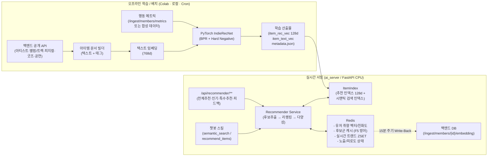

# INDIG 개인화 추천 & 시맨틱 검색 시스템 설계서

> **목적**: `app/recommender/` 실제 구현 전, 요구사항·데이터 흐름·모델·리랭킹·API·인프라 제약을 확정하기 위한 설계 기준서입니다.  
> **기준 백엔드**: `v2_API_명세서.md` (2026-11-26) · **라우터 Prefix**: `/api/recommender`

---

## 1. 핵심 요구사항 정리

| 영역 | 요구사항 | 핵심 설계 포인트 |
|---|---|---|
| **온보딩 (Cold-Start)** | 가입 시 선택한 아티스트(`artistIds`, 최소 1명)로 초기 취향 형성 | 선택 아티스트 임베딩 평균으로 초기 유저 벡터 생성 (+ 선택적 밴드 체인 유사 아티스트 추천) |
| **전체 추천** | 자주 보거나 좋아하는 아이템, 연관 아이템, 유사 유저가 보는 아이템 추천 | Two-Tower 하이브리드(`IndieRecNet`) + 실시간 팬덤 트렌드(Lift) + 크로스 카테고리 전이 |
| **전체 인기** | 유저 특성과 무관하게 현재 인기 있는 카테고리별 아이템 추천 | 비로그인 공개 · 최근 24h/7d 시간 감쇠 인기도 스코어 |
| **특수 추천 (상세 하단)** | 상세 페이지 하단에 해당 아이템/아티스트와 연관된 아이템 추천 | Item-to-Item 임베딩 유사도 + Co-occurrence(함께 본 아이템) + 로그인 시 미세 개인화 |
| **크로스 카테고리 반영** | 한 카테고리(예: 한로로 굿즈) 집중 탐색 시 아티스트·공연·음반 등 전 카테고리 반영 | Shared Embedding Space + 유저별 `artist_affinity` / `genre_affinity` 통합 관리 |
| **음악 팬덤 특화 피로도** | 무시(미클릭) 반복 시 새 아이템 탐색 유도하되, **계속 열어보는 아이템은 새로고침해도 유지** | `노출 후 미클릭(Cooldown)`과 `반복 진입(Sticky Retention)` 분리 설계 |
| **자연어 시맨틱 검색** | AI 챗봇이 `"우울, 회복, 안정, 비"` 같은 감성·상황 키워드로 아이템 검색 | 별도 **순수 텍스트 시맨틱 인덱스**(장르 + 바이오 + 앨범 설명 + 트랙 `tempo/moods/emotions/styles`) + 챗봇 내부 함수 직접 연동 |

---

## 2. 전체 아키텍처 (Lambda: 배치 학습 + 실시간 스피드 레이어)



---

## 3. 임베딩 & 모델 설계 (인덱스 이중화)

추천과 자연어 검색은 목적이 다르므로 **같은 아이템에 대해 2개의 벡터 공간**을 운용합니다.

### 3-1. 아이템 텍스트 문서 구성 (백엔드 v2 데이터 최대 활용)
백엔드 v2 API는 단순 이름·장르 외에 풍부한 자연어/태그 데이터를 제공합니다.

- **아티스트 (`ARTIST:{id}`)**:
  `이름 + genres[] + gender + composition + label + debutYear + bio + 최근 발매 앨범 description + 소속 트랙들의 상위 moods/emotions/styles/tempo`
  - **최신 발매 가중치**: 신규 앨범·트랙의 장르/무드/스타일을 문서 상단에 반복/강조 배치하여, 관리자가 아티스트 기본 장르를 수정하지 않아도 음악적 전환(예: 락 → 재즈)이 자동 반영되도록 합니다.
- **앨범/트랙 기반 시맨틱 보강**:
  `GET /api/catalog/albums/{id}`의 트랙별 `tempo`(`SLOW|MID|FAST|VERY_FAST`), `moods`(`DREAMY|DARK|CALM|...`), `emotions`, `styles`를 한글 감성 키워드와 함께 문서에 통합합니다.  
  → `"우울, 비, 잔잔한, 새벽"` 같은 자연어 쿼리가 `SLOW + DARK + CALM + DREAMY` 성향의 아티스트·앨범과 정확하게 매칭됩니다.
- **피지컬 앨범 (`PHYSICAL_ALBUM:{id}`)**:
  `아티스트명 + 앨범명 + format(LP/CD/CASSETTE) + 장르 + 판본 description + 앨범 트랙 무드`
- **굿즈 (`GOODS:{id}`)**:
  `아티스트명 + 굿즈명 + category + 장르 + 상품 description`
- **공연 (`CONCERT:{id}`)**:
  `공연명 + type(SOLO/FESTIVAL) + 장르 + 라인업 아티스트명/장르 + 공연장/지역(region) + 공연 description`

### 3-2. 인덱스 1: 시맨틱 검색용 순수 텍스트 인덱스 (`text_vectors`)
- **목적**: AI 챗봇 자연어 검색(`semantic_search`), 신규 아이템 Cold-Start, 장르 변경 즉시 반영.
- **특징**: 행동 로그 노이즈가 섞이지 않은 순수 의미 벡터 → `"기분 우울할 때, 비 오는 날, 회복"` 같은 감성·상황 질의에 높은 정확도 유지.

### 3-3. 인덱스 2: 개인화 추천용 하이브리드 인덱스 (`rec_vectors`, 128차원)
- **목적**: 전체 추천, 특수 추천(유사 아이템), 크로스 카테고리 추천.
- **PyTorch 모델 (`IndieRecNet`)**:
  - `text_projector`: `Linear(D_text -> 256) -> LayerNorm -> ReLU -> Dropout -> Linear(256 -> 128)`
  - `behavior_embedding`: `nn.Embedding(num_items, 128)` (유저 세션/메트릭의 공출현 학습)
  - `alpha`: `nn.Parameter(torch.tensor(0.5))` (아이템 텍스트 vs 행동 비중 자동 학습, `sigmoid`로 `[0, 1]` 제한)
  - `final_vec = F.normalize(alpha * text_feat + (1 - alpha) * behav_feat, dim=-1)`
- **학습 손실 함수**:
  - **BPR Loss** (Positive vs Negative 순위 학습)
  - **Hard Negative 가중치(2~3배)**: `BOUNCE`, `SKIP(3회+)`, `DISLIKE`, `UNFOLLOW` 아이템은 코사인 유사도가 음수 방향이 되도록 밀어냄.
- **오프라인 평가 지표**: `Hit Rate@10`, `NDCG@10`, `Recall@10` 및 하이퍼파라미터(`embed_dim`, `lr`, `dropout`, `neg_weight`) 튜닝 실험 기록.

---

## 4. 크로스 카테고리 취향 모델 (UserTasteState)

유저가 **특정 카테고리(예: 한로로 굿즈)**를 집중 탐색하면 **모든 카테고리(아티스트·피지컬·굿즈·공연)**에 즉시 반영되도록 유저 상태를 3가지 축으로 관리합니다.

```json
{
  "vector": [0.12, -0.04, "... (128d L2-normalized)"],
  "artist_affinity": { "12": 4.8, "7": 2.1 },
  "genre_affinity": { "INDIE_ROCK": 3.5, "DREAM_POP": 2.0 },
  "preferred_regions": { "SEOUL": 2.0 },
  "impression_counts": { "CONCERT:42": 2 },
  "revisit_counts": { "CONCERT:15": 4 },
  "purchased_items": ["CONCERT:9"],
  "seen_fresh_items": ["PHYSICAL_ALBUM:88"],
  "updated_at": 1764200000.0
}
```

### 4-1. 행동 가중치 & 실시간 업데이트 (Time Decay)
- **긍정 행동**: `DETAIL_VIEW(+1.0)`, `PREVIEW_PLAY(+1.5)`, `DWELL ≥ 30s(+2.5)`, `SEARCH_CLICK(+2.5)`, `RECOMMEND_CLICK(+2.0)`, `SHARE(+3.0)`, `CART_ADD(+3.5)`, `FOLLOW(+4.5)`, `PURCHASE / BOOKING(+5.0)`
- **부정 행동**: `BOUNCE < 3s(-2.0)`, `SKIP 3회(-1.5)`, `CART_REMOVE(-1.0)`, `UNFOLLOW(-4.0)`, `DISLIKE(-5.0)`
- **업데이트 공식**:
  1. `vector_new = normalize(decay * vector_old + lr * weight * item_rec_vec)`
  2. 해당 아이템의 `artist_ids` 전부 `artist_affinity[aid]`에 `weight` 누적 (Time Decay 적용)
  3. 해당 아이템의 `genres` 전부 `genre_affinity[g]`에 `weight * 0.5` 누적
- **크로스 카테고리 전이 예시**:
  - 유저가 `GOODS:101`(한로로 티셔츠)을 반복 조회/장바구니 담기 → `artist_affinity[한로로]` 급상승 + `vector`가 한로로 클러스터로 이동.
  - 직후 `concerts` 또는 `artists` 탭 진입 → 한로로의 예정 공연, 한로로 아티스트 카드, 한로로와 유사한 아티스트/공연이 최상위권에 노출.

### 4-2. 실시간 반영 vs 배치 재학습 경계 & 이벤트 유입 경로
- **실시간(즉시, 수 ms ~ 수 초) 반영 대상 (Redis 스피드 레이어)**:
  - 유저 취향 벡터(`user.vector`), `artist_affinity` / `genre_affinity`, 피로도(Cooldown) & 반복진입(Sticky), 실시간 트렌드(`rec:trend:global`, `rec:trend:fan_of:{artist}`).
  - **캐시 즉시 무효화 규칙**: 단순 새로고침(F5)은 10분 캐시된 Top-50 풀에서 10ms 미만으로 응답하지만, 유저가 **클릭·팔로우·장바구니·관심없음(`DISLIKE`)** 등 의미 있는 피드백을 발생시키면 **해당 유저의 후보군 캐시(`{user_uuid}:rec:cand:*`)를 즉시 삭제**해 다음 요청부터 변화가 바로 반영되게 합니다.
- **배치(주기적, 예: 1일 1회) 반영 대상 (PyTorch 재학습)**:
  - `IndieRecNet` 신경망 가중치(`text_projector`, `alpha`)와 아이템별 `behavior_embedding` 영구 좌표(매 클릭마다 역전파하면 CPU/메모리 과부하 및 노이즈 오염 발생).
- **행동 이벤트 유입 경로**:
  1. **프론트 즉시 전달 (실시간)**: 상세 조회·체류·클릭·스킵·관심없음 등 프론트 이벤트를 기존 `/api/members/me/metrics`와 함께 `POST /api/recommender/feedback`으로도 경량 비동기 전송.
  2. **백엔드 서버 이벤트 동기화 (준실시간/배치)**: 구매(`PURCHASE`)·예매(`BOOKING`)·팔로우(`FOLLOW`)·검색(`SEARCH`) 등 서버 기록 이벤트는 `GET /ingest/members/{userId}/metrics` 조회(또는 추후 Kafka 구독)로 합산.

### 4-3. 영속화 전략 (Redis Write-Back)
- 평상시: Redis(`{user_uuid}:rec:taste`, TTL 24시간)에만 실시간 갱신 + `rec:dirty_users` Set 등록.
- 주기 백업(15분): `PUT /ingest/members/{userId}/embedding`으로 백엔드 DB 백업.
- Redis Cache Miss 복구 순서: ① `GET /ingest/members/{userId}/embedding` → ② 없으면 `GET /api/members/follows` + `GET /ingest/members/{userId}/metrics`로 즉석 재구성 → ③ 둘 다 없으면 인기 기반 폴백.
- *(HMAC 키 미발급 기간 동안은 Redis 단독 + 팔로우 API 기반 폴백으로 무중단 동작)*

---

## 5. 음악 팬덤 특화 피로도 & 재노출 정책 (핵심 차별화)

일반 SNS("본 글 숨김")와 달리, **음악 팬덤의 반복 소비 패턴**을 반영합니다.

| 유저 행동 패턴 | 판정 | 스코어 보정 | 결과 |
|---|---|---|---|
| **노출됐는데 클릭 안 함** (`impression >= 2`, `revisit == 0`) | 관심 없음 / 피로도 누적 | `-0.18 * (impression - 1)` (Cooldown, TTL 1시간) | 새로고침 시 뒤로 밀리고 **새로운 아티스트/아이템 노출** |
| **새로고침마다 반복 클릭·체류** (`revisit >= 1`) | 강한 관심 / 재방문 | **피로도 감점 면제** + `+0.10 * log1p(revisit)` (Sticky Retention) | 새로고침해도 해당 공연/상품이 **안정적으로 계속 노출** |
| **이미 예매 완료한 공연** (`BOOKING` 완료) | 소비 완료 | 해당 공연만 `-1.0` (하위 이동/제외), **같은 아티스트의 다른 굿즈·LP는 유지/부스트** | 이미 산 티켓은 안 띄우고 연관 상품 추천 |
| **품절 상품 / 종료 공연** (`soldOut`, `CLOSED`) | 구매/예매 불가 | 하드 필터 제외 (단, 사용자가 필터로 품절 포함 선택 시 허용) | 헛클릭 방지 |
| **신규 업데이트** (신보·새 공연·재입고, 최근 7일) | Freshness | 최초 노출 시 `+0.30` 상단 부스트 → 1회 노출 후 `seen_fresh_items` 등록해 부스트만 제거 | 첫 진입 시 새 소식 상단, 새로고침 시 자연스럽게 섞임 |

---

## 6. 4가지 기능별 스코어링 & API 설계

### 6-1. 전체 추천 — `GET /api/recommender/{category}` (로그인)
- **후보 추출 (Top-100 → Top-50 풀링)**:
  1. `ItemIndex.search(user.vector, target_type=category, top_k=50)` (취향 유사도)
  2. 유저 상위 `artist_affinity` Top-5의 아이템 및 `rec:trend:fan_of:{artist}` Top-10 (크로스 카테고리 + 팬덤 실시간 트렌드)
  3. `rec:trend:global:{category}` Top-10 (전체 급상승)
  4. 신규 발매/오픈 아이템 Top-10 (Freshness)
- **최종 리랭킹 스코어**:
  $$\text{Score} = 0.45 \cdot S_{\text{taste}} + 0.20 \cdot S_{\text{artist\_aligned}} + 0.15 \cdot S_{\text{fandom\_lift}} + 0.10 \cdot S_{\text{global\_hot}} + 0.10 \cdot S_{\text{fresh}} + S_{\text{context}} + S_{\text{fatigue\_or\_sticky}} + \varepsilon$$
  - **앨범/아이템 장르 정합성 게이트 ($S_{\text{artist\_aligned}}$)**:
    $S_{\text{artist\_aligned}} = S_{\text{artist\_affinity}} \times (0.4 + 0.6 \cdot S_{\text{item\_genre\_match}})$  
    → 같은 아티스트의 아이템이라도 락 팬에게는 락 앨범에, 재즈 팬에게는 재즈 앨범에 가산점이 집중되도록 분리합니다.
  - **Lift 보정 & 음수 페널티 유지 ($S_{\text{fandom\_lift}}$)**:
    $S_{\text{fandom\_lift}} = \frac{\text{fan\_trend}(A \to B)}{\text{global\_trend}(B) + 1}$  
    → 특정 팬덤에서만 급상승한 아이템을 해당 팬덤에 집중 노출하며, 반대로 특정 팬덤이 회피(`SKIP`/`BOUNCE`)해 `fan_trend`가 **음수**가 된 경우에는 `0`으로 자르지 않고 음수 페널티를 그대로 반영합니다.
  - **글로벌 급상승 전용 슬롯 보장**: 취향과 무관하게 전체 검색/조회가 급증한 아이템이 관련 없는 유저에게도 노출되도록, 페이지(20개) 내 1~2칸(예: 5번째·12번째 자리)에 `rec:trend:global:{category}` 상위 아이템을 슬롯으로 보장합니다(단, 유저가 `DISLIKE`하거나 음수 팬덤 페널티가 큰 아이템은 제외).
  - **맥락 가산점 ($S_{\text{context}}$)**: 심야(23~04시) `CALM/DREAMY/SLOW`·LP `+0.08`, 금~일 `FESTIVAL/ENERGETIC`·공연 `+0.08`, 선호 지역 일치 공연 `+0.10`
- **다양성 제어 (Diversity Cap)**:
  - 페이지(20개) 내 동일 `artist_id`가 `REC_MAX_ARTIST_PER_PAGE`(기본 2개, 단 유저가 반복 진입 중인 Sticky 아이템은 최대 3개까지 허용)를 초과하면 후순위로 감점 배치.
- **F5 연타 & Cache Stampede 방어**:
  - Top-50 스코어 결과를 Redis에 캐싱(TTL 10분) + `page=0` 재요청 시 상위 50개 풀에서 Softmax/가중치 샘플링 + Sticky 유지로 **<10ms 응답**.
  - 캐시 미스 시 동시 다발 F5 연타를 막기 위해 `{user_uuid}:rec:cand:{category}:lock` 분산 락(Singleflight)을 적용해 동시 요청이 와도 계산은 1회만 수행합니다.
- **추천 이유 태그 (`reason_type` / `reason_text`)**:
  - 가장 기여도가 높은 항을 근거로 반환 (예: `"최근 자주 본 한로로 관련 공연"`, `"비슷한 취향의 팬들이 요즘 많이 찾는 아티스트"`, `"방금 오픈한 새 공연"`).

### 6-2. 전체 인기 — `GET /api/recommender/popular/{category}` (공개)
- 로그인 불필요.
- 시간 감쇠 인기도: `0.6 * 최근 24시간 트렌드(ZSET) + 0.3 * 최근 7일 누적 인기도 + 0.1 * 팔로워/기본 인기도`.
- 마감 공연·품절 상품 기본 제외, Diversity Cap 적용.
- Redis에 카테고리별 1~5분 캐싱.

### 6-3. 특수 추천 (상세 페이지 하단) — `GET /api/recommender/similar/{target_type}/{item_id}` (공개 · 로그인 선택)
- **아티스트 상세 (`ARTIST`)**:
  - `0.55 * Item-to-Item 임베딩 유사도(128d) + 0.30 * Co-occurrence(함께 좋아함/팬덤 트렌드) + 0.15 * 장르/무드 겹침`
  - 자기 자신 제외.
- **공연 / 피지컬 / 굿즈 상세 (`CONCERT` / `PHYSICAL_ALBUM` / `GOODS`)**:
  - 같은 아티스트의 다른 활성 아이템 우선 후보 + 유사 아티스트의 같은 카테고리 아이템 결합.
  - 로그인 쿠키가 있으면 유저 `vector` 유사도 `+0.15` 미세 개인화 적용.

### 6-4. 자연어 시맨틱 검색 — `POST /api/recommender/semantic-search` (+ 챗봇 내부 함수 직접 호출)
- **요청**:
  ```json
  {
    "query": "우울, 회복, 안정, 비, 잔잔한",
    "categories": ["artists", "concerts"],
    "size": 10
  }
  ```
- **동작**:
  1. `query`를 텍스트 임베딩 모델로 벡터화.
  2. **순수 텍스트 인덱스(`text_vectors`)**에서 1차 코사인 유사도 Top-K 검색(`S_text`).
  3. **행동 클러스터 보정(`S_behavior`)**: 1차 텍스트 상위 앵커 아이템들의 128d 추천 벡터 평균(해당 키워드/장르의 행동 클러스터 중심)과 후보 아이템의 128d `rec_vectors` 유사도를 계산해 **`0.75 * S_text + 0.25 * S_behavior`**로 결합합니다.  
     → 관리자 입력 텍스트에 `'재즈'`가 없더라도 재즈 팬들이 대거 유입된 아티스트가 자연어 `'재즈'` 검색 결과에 자연스럽게 포함됩니다.
  4. 선택적으로 로그인 유저의 `vector`를 아주 약하게(`0.10`) 가미해 동점권에서 취향 우선 정렬.
  5. **챗봇 연동**: [app/chatbot/skill.py](file:///c:/Users/wnsdn/DEV/Web/sw-academy-workspace/ai_server/app/chatbot/skill.py)에 `semantic_search_catalog(query, categories)` 스킬을 추가해 HTTP 왕복 없이 `recommender.service.semantic_search()`를 **직접 호출** (초저지연 + Gateway 5회/분 한도 추가 소모 없음).

### 6-5. (선택) 온보딩 밴드 체인 — `GET /api/recommender/onboarding/similar` (공개)
- 가입 화면에서 아티스트 1명 클릭 시 `?artistId=&exclude=1,2,3&size=3`으로 비슷한 밴드 3팀을 즉시 반환 (`exclude` 선제외 후 Top-K).

---

## 7. 인프라 & 기술 스택 결정 포인트 (질의응답 전 체크)

현재 [Dockerfile](file:///c:/Users/wnsdn/DEV/Web/sw-academy-workspace/ai_server/Dockerfile)이 **AWS `t4g`(arm64) + 온프레미스(amd64) 멀티아치** + **루트 파일시스템 읽기 전용(`/tmp`만 쓰기)** 환경이므로, 구현 전 아래 2가지를 확정해야 합니다.

### 결정 1: 텍스트 임베딩 & 벡터 검색 서빙 방식 → **옵션 B 확정**
> ✅ **확정 (2026-11-27)**: 학습은 오프라인 PyTorch(`train` optional dependency), 운영 서빙은 **`Gemini Embedding (gemini-embedding-001)` + `NumPy` 이중 인덱스**로 확정합니다.
| 항목 | 옵션 A: 로컬 `ko-sroberta` + `faiss-cpu` | 옵션 B (권장): Gemini Embedding + NumPy 서빙 (+ PyTorch 오프라인 학습) |
|---|---|---|
| **Docker 이미지 크기** | ~2.5~4 GB (`torch` + 모델 가중치) | ~250 MB (현재 수준 유지) |
| **K8s RAM 사용량** | ~1.5~2.0 GB (t4g 노드 압박 주의) | ~150~300 MB |
| **arm64 멀티아치 호환** | `faiss-cpu` / `torch` 빌드 검증 필요 | 100% 무문제 (`numpy`만 사용) |
| **자연어 검색 속도** | 로컬 CPU ~30~80ms | Gemini Embedding API ~150~300ms (쿼리 캐싱 시 <1ms) |
| **직접 모델 학습 어필** | PyTorch `IndieRecNet` 학습·튜닝 동일 | PyTorch `IndieRecNet` 학습·튜닝 동일 (학습은 별도 `train/` 스크립트, 서빙은 추출된 가중치/벡터 로드) |

### 결정 2: 백엔드 연동 타이밍
- **카탈로그/공연 데이터**: 공개 `GET` API로 지금 즉시 동기화 가능.
- **행동 메트릭 & 벡터 백업(`/ingest/members/**`)**: 백엔드 팀원에게 `ingest.member-keys.*` 키 발급 요청 필요 (발급 전까지는 Redis 단독 저장 + 합성 데이터 학습으로 개발/검증 가능).
- **Gateway 라우팅**: `/api/recommender/**` 경로를 Gateway에 추가 (챗봇의 분당 5회 한도와 분리, `/popular/**`·`/similar/**`·`/onboarding/**`는 공개 경로 허용).

---

## 8. 구현 로드맵 (확정 후 진행 순서)

1. **Phase 1 — 데이터 동기화 & 임베딩 파이프라인**: 백엔드 카탈로그/공연 수집 → 아이템 문서 빌더 → 텍스트 임베딩 생성 & `ItemIndex`(추천/시맨틱 이중 인덱스) 구현.
2. **Phase 2 — PyTorch `IndieRecNet` 학습 & 평가**: 합성 행동 로그 생성기 + BPR/Hard Negative 학습 스크립트 + `Hit Rate@10` / `NDCG@10` 평가 + 산출물 내보내기.
3. **Phase 3 — 실시간 추천·인기·특수추천·피로도 서빙**: Redis `UserTasteState`, Sticky/Cooldown 피로도, Lift 실시간 트렌드, Diversity Cap, F5 캐싱, Write-Back 구현.
4. **Phase 4 — 시맨틱 검색 & 챗봇 스킬 연동**: `POST /api/recommender/semantic-search` 구현 및 [app/chatbot/skill.py](file:///c:/Users/wnsdn/DEV/Web/sw-academy-workspace/ai_server/app/chatbot/skill.py)에 챗봇 검색/추천 도구 연결 + 테스트 검증.
